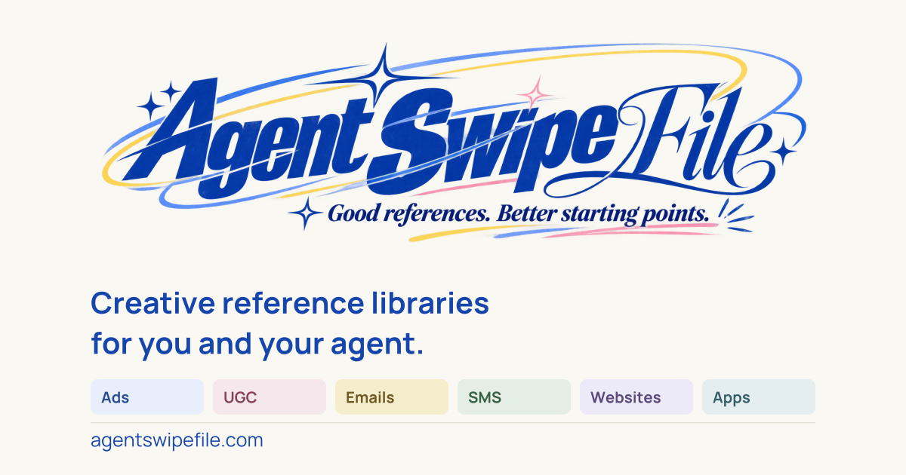

# Agent Swipe File



Find the right creative reference library for your next ad, email, website, app, or agent workflow.

Website: [agentswipefile.com](https://agentswipefile.com)

This open skill reads a public directory of creative libraries and tools. It compares fit, source access, documented integrations, pricing evidence, and practical limits. No authentication, API key, paid model, or MCP server is required to use the skill. Listed products may have their own access requirements.

## Install

Copy `skills/agentswipefile` into the skills directory supported by your agent. For Codex, use `~/.codex/skills/agentswipefile`; for Claude Code, use `~/.claude/skills/agentswipefile`. Other agents can read the same `SKILL.md` instructions directly. Invocation syntax depends on the host: commonly `/agentswipefile` or `$agentswipefile`.

Examples:

```text
/agentswipefile Find an email reference library with a Figma plugin and a free tier.
/agentswipefile I need mobile onboarding references my Claude workflow can access through MCP.
/agentswipefile Find free paid-social inspiration and a way to organize references.
```

## Public entry points

Browse ten asset categories and eight more specific topics, including hooks, prompts, brand identities, UI components and paywalls. The Python helper can combine them with documented integrations and pricing requirements:

```bash
python3 skills/agentswipefile/scripts/find_resources.py --asset apps --subcategory product-flows --requires mcp
python3 skills/agentswipefile/scripts/find_resources.py --asset social --subcategory hooks
```

- [Structured catalog](https://agentswipefile.com/catalog.json)
- [Agent index](https://agentswipefile.com/llms.txt)
- [Human and agent guide](https://agentswipefile.com/for-agents/)
- Resource Markdown: `https://agentswipefile.com/resources/{slug}.md`

The optional Python helper uses only the standard library. It sends public GET requests to agentswipefile.com and does not send the user's task to the directory. Matching happens locally. If the live catalog is unavailable, report that limitation rather than inventing facts.

## Understand the plan before recommending

Free access may be a limited preview. It does not mean the full library, MCP, API or plugin is free. Read the complete `workflow.pricing` object: plan tiers, billing periods, seat minimums, preview limits and separate business access. For example, Refero offers a limited free preview alongside paid Pro, Team and Lifetime access. Use the live catalog and official pricing page for current amounts.

The skill treats vendor pages as evidence, preserves uncertainty, and does not install tools, connect accounts, or spend money. Featured placement does not influence its keyword ranking.

## License

The original skill instructions and helper code are MIT licensed. Linked vendor content, trademarks, screenshots, and product libraries retain their own rights. No vendor content is bundled in this repository.
